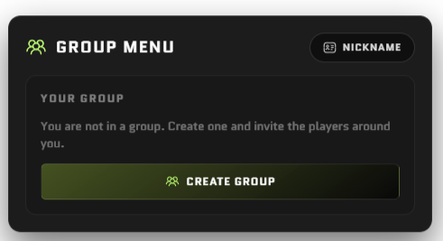
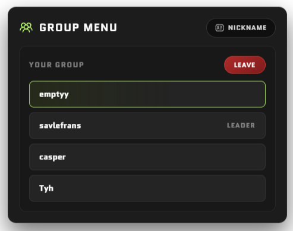
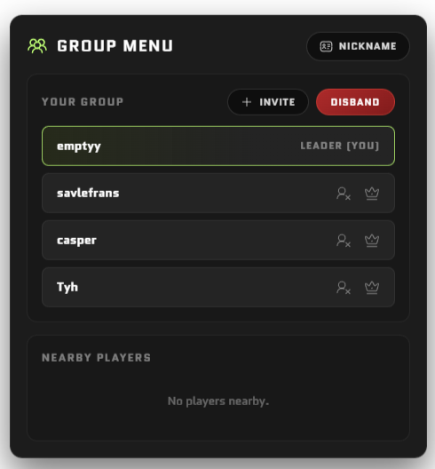

<div align="center">

<h2>royal-groups</h2>
royal's player group system for FiveM

[](https://github.com/overextended/ox_lib)
[](LICENSE)


</div>

---

## ⚠️ This is not a drag and drop script ⚠️

Dropping this in your server and starting it will **not** give players anything
to do. It has no missions, no jobs, no payouts and no gameplay of its own.

It is a **tool**. It creates player groups and gives you data about them — is
this player in a group, who else is in it, who leads it — and it lets you fire
an event at everyone in a group at once.

You write the mission, heist, race or job script, and you ask this resource who
to run it for. If you are looking for a finished activity, this is not it.

## Preview

<div align="center">

| No Group | Member | Leader |
| :---: | :---: | :---: |
|  |  |  |

</div>

## Installation

1. Download the latest release.
2. Place it inside your `resources` folder.
3. Make sure [ox_lib](https://github.com/overextended/ox_lib) is started before it.
4. Ensure `royal-groups` in your `server.cfg`.
5. Restart the server.

Players open the menu with `/groups`. From there they can create a group, invite
by player id or from the nearby list, kick, promote, leave, disband, and set a
nickname.

A group id looks like `RYL-0000000000` and is generated when the group is
created. It is the handle you pass to every server export.

## Configuration

`shared/config.lua`:

| Option | Meaning |
| --- | --- |
| `Config.Command` | Command that opens the menu (`groups`) |
| `Config.NearbyRadius` | Radius in metres for the "Nearby Players" list |
| `Config.NicknameLength` | Max length of a player's nickname |
| `Config.InviteTimeout` | Seconds an invite stays valid |

Colours live in `web/src/style.css`:

```css
:root {
	--main-color: #BFFF74;
}
```

## Server exports

All of these take a **group id** except `FindGroupByMember`, which takes a
player's server id.

### `GetGroupLeader(groupID)`

Server id of the group's leader, or `nil` if the group does not exist.

```lua
local leader = exports['royal-groups']:GetGroupLeader(groupId)
```

### `GetGroupSize(groupID)`

Number of players in the group. Returns `0` for an unknown group, so it is safe
to compare without checking the group exists first.

```lua
if exports['royal-groups']:GetGroupSize(groupId) < 3 then
    -- not enough players for this mission
end
```

### `GetGroupMembers(groupID)`

Array of the members' server ids, in join order. Returns an empty table for an
unknown group. This is a **copy** — mutating it does not affect the group.

```lua
for _, playerId in ipairs(exports['royal-groups']:GetGroupMembers(groupId)) do
    -- pay each member
end
```

### `FindGroupByMember(playerID)`

The group id a player belongs to, or `nil` if they are not in one.

```lua
local groupId = exports['royal-groups']:FindGroupByMember(source)
if not groupId then
    -- tell them to form a group first
end
```

### `GroupEvent(groupID, eventname, ...)`

Fires a client event on every member of the group. Any extra arguments are
passed through to the event. Returns `true` if the group existed, `false` if
nothing was fired.

```lua
exports['royal-groups']:GroupEvent(groupId, 'my-heist:client:start', {
    stage = 1,
    coords = vec3(0.0, 0.0, 0.0),
})
```

## Client exports

### `GetGroupID()`

The group id the player is in, or `nil`. Answered from a locally cached copy of
the group, so it costs nothing to call.

```lua
local groupId = exports['royal-groups']:GetGroupID()
```

### `IsGroupLeader()`

`true` if the player leads their group. Also cached locally.

```lua
if exports['royal-groups']:IsGroupLeader() then
    -- only let the leader start the job
end
```

> Never trust this for anything that matters — a client can lie. Check
> `GetGroupLeader()` on the server before you hand out money or start a mission.

### `openUI()` / `closeUI()`

Open or close the group menu, for binding it to your own key, command or
interaction point.

```lua
exports['royal-groups']:openUI()
```

## Example

Starting a mission for everyone in the caller's group, server side:

```lua
RegisterNetEvent('my-heist:server:start', function()
    local src = source
    local groupId = exports['royal-groups']:FindGroupByMember(src)

    if not groupId then
        return -- not in a group
    end

    if exports['royal-groups']:GetGroupLeader(groupId) ~= src then
        return -- only the leader starts it
    end

    if exports['royal-groups']:GetGroupSize(groupId) < 3 then
        return -- needs three players
    end

    exports['royal-groups']:GroupEvent(groupId, 'my-heist:client:start', groupId)
end)
```

## Nicknames

Players set a nickname in the menu. It is stored client side in KVP, so it
survives a reconnect and is applied automatically the next time they create or
join a group.

Because KVP is per FiveM installation, a nickname follows the **PC**, not the
character or the account. Players get the same nickname on every character, and
none at all on a different machine. If you need it per character, store it in
your database instead.

The nickname is what the resource uses whenever it names a player. Without one,
players are shown as `Player <id>`.

## 🙏 Credits

<table>
  <tr>
    <td align="center">
      <a href="https://github.com/overextended">
        
        <br />
        <sub><b>Overextended</b></sub>
      </a>
      <br />
      <sub>ox_lib</sub>
    </td>
  </tr>
</table>

Callbacks, dialogs and notifications are all handled by **[ox_lib](https://github.com/overextended/ox_lib)** from the [Overextended](https://github.com/overextended) team.

---

<div align="center">

**[Discord](https://discord.gg/H2bCPuqeT7)**

Made with 💚 by royal for the FiveM community

</div>
